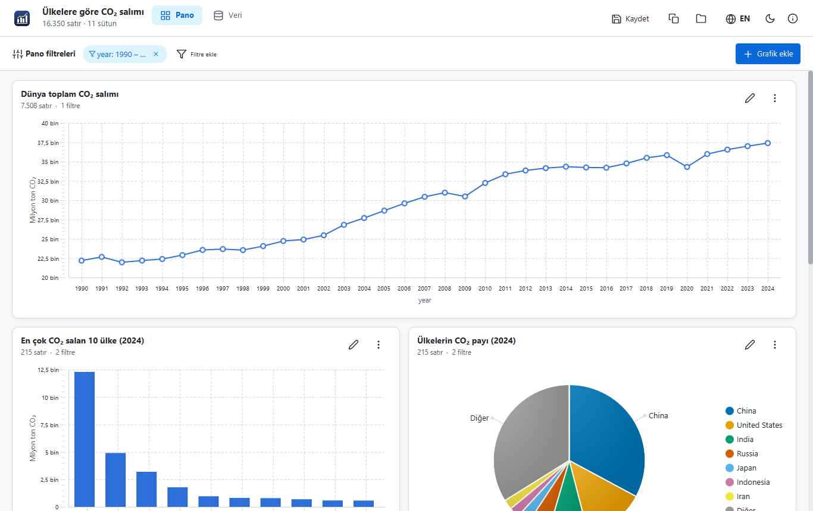
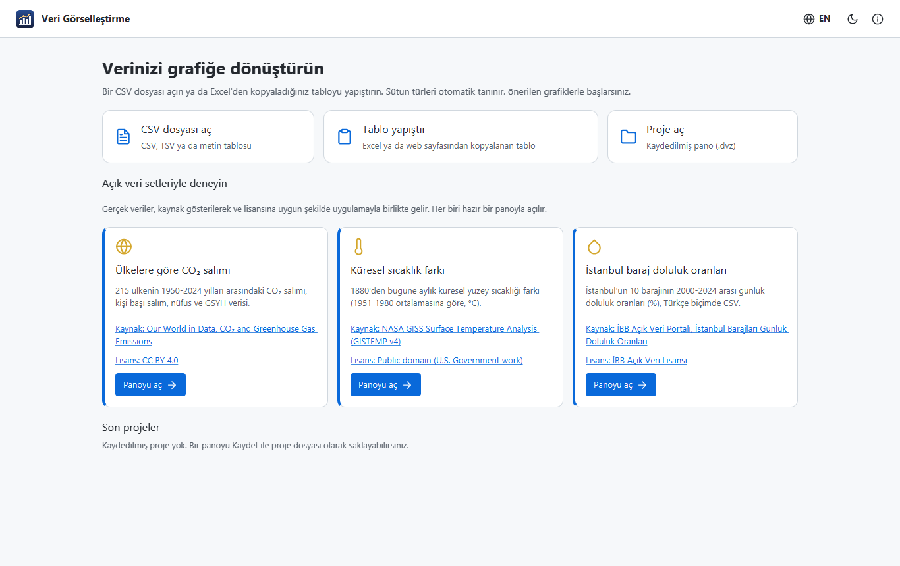
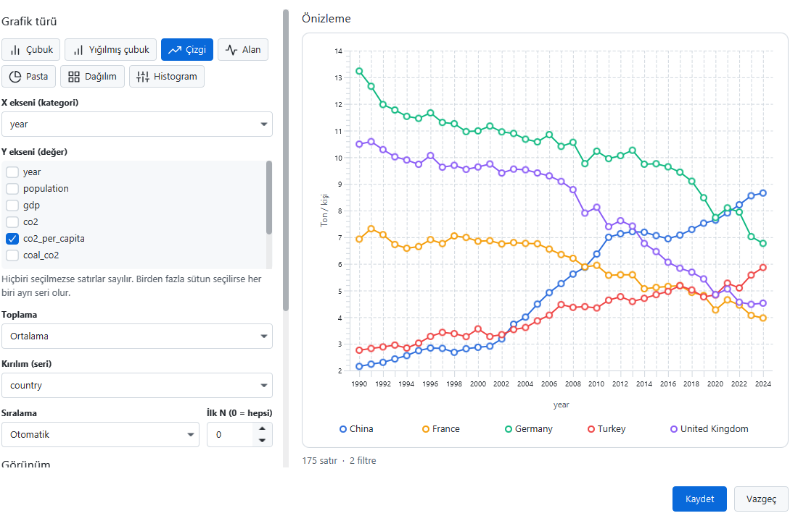
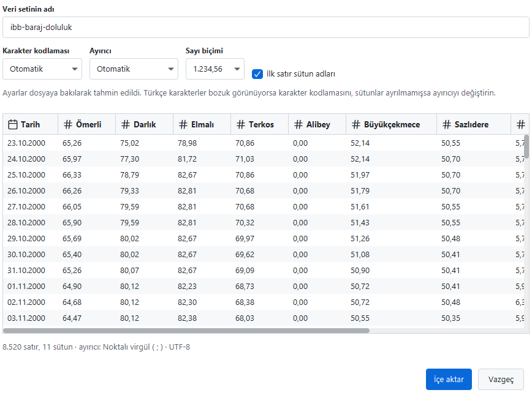
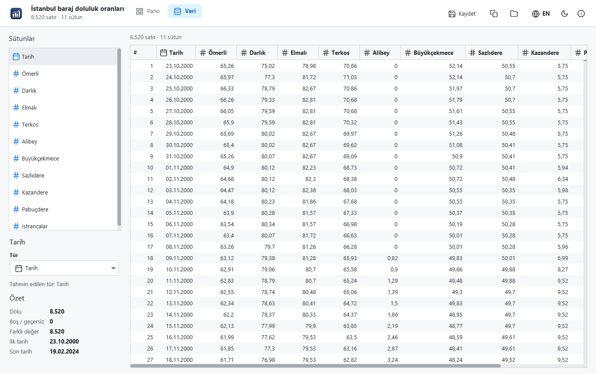
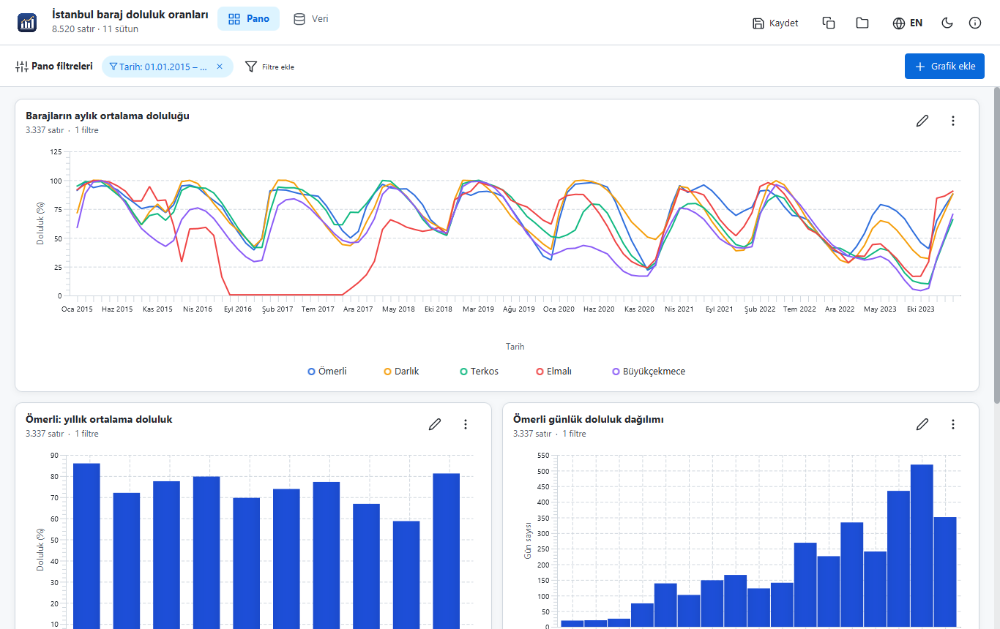
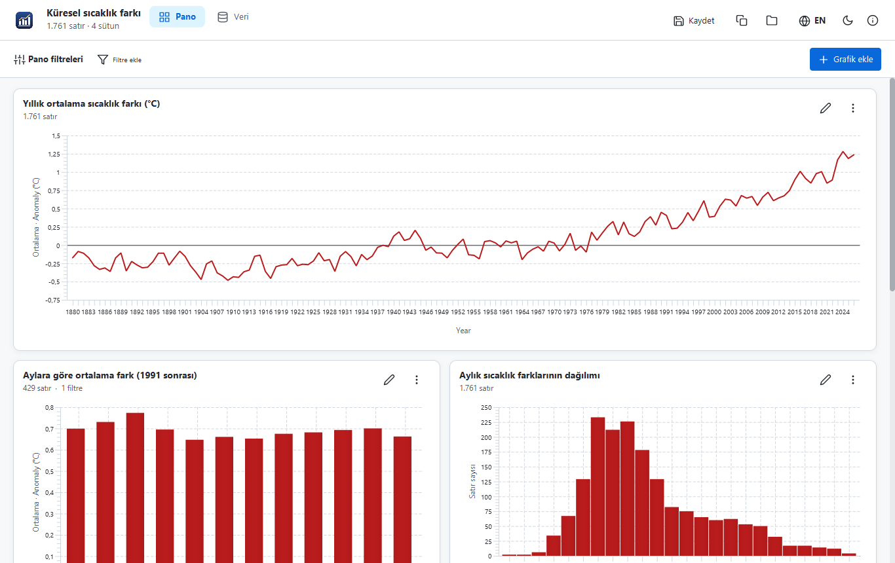
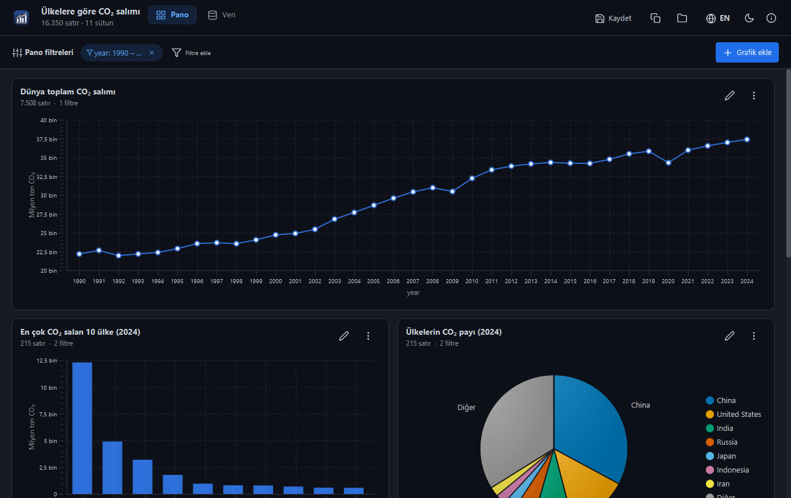

<p align="center">
  
</p>

<h1 align="center">Data Visualizer</h1>

<p align="center">
  <b>English</b> | <a href="README.tr.md">Türkçe</a>
</p>

<p align="center">
  A desktop data visualization app written in Java and JavaFX: open a CSV file or paste a table, let the app<br>
  detect the column types, and build a <b>dashboard of charts</b> with grouping, aggregation and filters.
</p>

<p align="center">
  <a href="https://github.com/MrcDprm/data-visualization-system/releases/latest"><b>⬇️ Download for Windows</b></a>
</p>

<p align="center">
  
</p>

> This is a portfolio project. It runs locally and does not send your data anywhere. Three real open datasets ship with the app so you can try it right away; their sources and licenses are listed [below](#data-sources).

## Features

**Importing data**
- **CSV / TSV files** and **tables pasted from Excel** or a web page
- Automatic detection of the **encoding** (UTF-8, UTF-8 with BOM, UTF-16, Turkish Windows-1254), the **delimiter** (`,` `;` tab `|`), the **header row** and the **number format** (`1,234.56` or Turkish `1.234,56`)
- **Column types** (number, date, text) are guessed from the values; dates such as `2024-02-19`, `19.02.2024`, `02/19/2024` or `2024-02` are recognised. Every guess can be changed in the import window or on the Data tab
- Messy files are handled: quoted fields with delimiters and line breaks, missing or duplicate column names, rows with too few or too many cells, percent and currency signs. The app shows a warning instead of failing

**Charts**
- **Bar, stacked bar, line, area, pie, scatter and histogram**
- X axis, one or more Y columns, a **breakdown column** for series, and **aggregation** (sum, average, count, minimum, maximum)
- **Date grouping** by day, month, quarter or year
- Sorting, **top N** (a pie chart puts the rest into "Other"), histogram bins with readable edges
- Title and axis names, **colour palettes** including a colour-blind friendly one
- **Live preview** in the chart editor; suggested charts are added automatically for a new dataset

**Dashboard**
- Several chart cards side by side, narrow or wide, which can be duplicated and moved
- **Dashboard filters** that apply to every chart, and **chart filters** for a single chart: values for text columns (with search), ranges for numbers and dates
- **Show data as a table** and save it as CSV, **save a chart as PNG** at 2x resolution
- **Project files** (`.dvz`) keep the dataset reference, column types, filters and charts; double-clicking a project file opens it. If the data file was moved, the app asks where it is

**Data tab**
- The data itself, with cells that do not fit the chosen type shown in red
- Per column: type, filled and empty cells, distinct values, minimum, maximum, average and sum, first and last date, most frequent values

**Safety**
- Files are treated as untrusted: size, row, column and cell length limits; project files are validated field by field
- CSV exports are protected against **formula injection**: text cells starting with `=`, `+`, `-` or `@` cannot run as Excel formulas
- Unexpected errors show a short message, never a stack trace

**Desktop app**
- Turkish and English, light and dark theme (AtlantaFX)
- Settings and recent projects are stored in the user folder (`%APPDATA%\MrcDprm\DataVisualizer`)
- Windows installer, icon, version and About window

## Screenshots

| Start screen | Chart editor |
|:---:|:---:|
|  |  |
| **Importing a Turkish CSV** | **Data tab** |
|  |  |
| **Istanbul dams** | **Global temperature** |
|  |  |

<p align="center">
  
</p>

## Installation

1. Download `DataVisualizer-1.0.0-Setup.exe` from the [Releases](https://github.com/MrcDprm/data-visualization-system/releases/latest) page and run it. Java does not need to be installed; it is bundled.
2. Open one of the three sample dashboards on the start screen, or open your own CSV file.
3. Use **Save** to keep a dashboard as a `.dvz` project file.

Uninstall from the Windows "Apps" settings; the settings folder is kept and can be deleted by hand.

## Data Sources

The sample datasets are real open data, included under their licenses. They were trimmed and reformatted for the app (see the notes).

| Dataset | Source | License |
|---|---|---|
| CO₂ emissions by country (1950-2024) | [Our World in Data, CO₂ and Greenhouse Gas Emissions](https://github.com/owid/co2-data), based on the Global Carbon Project and the Energy Institute | [CC BY 4.0](https://creativecommons.org/licenses/by/4.0/) |
| Global temperature anomaly (1880-today) | [GISTEMP Team, NASA Goddard Institute for Space Studies, GISTEMP v4](https://data.giss.nasa.gov/gistemp/) | Public domain (U.S. Government work) |
| Istanbul dam occupancy (2000-2024) | [İBB Açık Veri Portalı, İstanbul Barajları Günlük Doluluk Oranları](https://data.ibb.gov.tr/dataset/istanbul-barajlari-gunluk-doluluk-oranlari), İSKİ | [İBB Açık Veri Lisansı](https://data.ibb.gov.tr/license) |

Notes: the CO₂ file keeps only countries (no regional aggregates) and 11 columns, with values rounded to 4 decimals. The temperature table was turned from one row per year into one row per month. The dam file was converted from Excel to a semicolon-separated CSV with percentages and Turkish number and date formats; 130 rows that had dates stored as text and values already in percent were normalised. This app is not affiliated with or endorsed by any of these organisations.

## Tech Stack

- **Java**, **Maven**
- **JavaFX**: user interface and charts
- **AtlantaFX** (theme), **Ikonli + Feather** (icons)
- **Gson**: project files (JSON)
- **JUnit**: tests
- **jpackage** + **Inno Setup**: Windows installer

## Project Structure

```
src/main/java/com/mrcdprm/dataviz/
├── data/      CSV reader, encoding/delimiter/header detection, number and date parsing, columns, statistics, sample datasets
├── chart/     Chart definition, filters, grouping and aggregation engine, histogram, scatter sampling, palettes, suggestions
├── project/   Project file (JSON) with validation, open workspace
├── ui/        Start screen, import, dashboard, chart cards and editor, filters, data tab, export, theme, translations
├── DataVizApp.java
└── Launcher.java
src/main/resources/   Styles, icon, Turkish and English texts, sample datasets
src/test/java/        JUnit tests
installer/            Build script, Inno Setup script and icon
```

## Building from Source

Requires a JDK (version in `pom.xml`) and Maven.

```
mvn test          # 28 tests
mvn javafx:run    # run the app
```

### Building the installer

Requires [Inno Setup](https://jrsoftware.org/isinfo.php).

```
powershell -ExecutionPolicy Bypass -File installer\build.ps1
ISCC installer\DataVisualizer.iss
```

`build.ps1` runs the tests, finds the JDK modules the app needs with `jdeps` and uses `jpackage` to create `dist\DataVisualizer` with a trimmed Java runtime. The installer is created in `installer\Output\` and also registers the `.dvz` file type for the current user.

**When releasing a new version:** update the version in `pom.xml`, `DataVizApp.VERSION`, `installer/build.ps1` and `installer/DataVisualizer.iss`, run both commands and upload the installer to a new GitHub Release.

## What I Learned

- **Real files are messy.** The Istanbul dam spreadsheet had 130 rows where the date was typed as text and the value was already a percentage while every other row stored a fraction. I wrote the preparation script to detect both cases and check that the dates came out in order. The importer itself copes with quotes, line breaks inside cells, missing headers, duplicate names and rows of the wrong length, and reports what it fixed instead of failing.
- **Guessing instead of asking.** The encoding is UTF-8 if the bytes decode cleanly, otherwise Turkish Windows-1254; the delimiter is the one that gives the same number of columns on most of the first 50 lines; a column is a number or a date only if at least 95% of a sample parses that way. Deciding between `1,234` as a thousand or one-and-a-bit needs the whole file, so the number format is decided once per file, with the semicolon as a hint for Turkish Excel exports. Every guess can be overridden.
- **A small query engine.** Filters turn into a bit set of matching rows; rows are grouped by the X value (dates rounded down to month, quarter or year), and each group and series keeps a sum, count, minimum and maximum, so any aggregation is one pass over the data. Sorting, top N with an "Other" slice and limits on categories, series and scatter points keep the charts readable and fast.
- **Readable numbers.** Histogram bin widths are rounded to 1, 2, 2.5 or 5 times a power of ten so the edges read like `-0.4 – -0.3`, axis labels use one unit for the whole axis ("25K", "1.25M"), and years are never printed with a thousands separator.
- **Never trusting a file, including my own.** Project files can come from anyone: unknown chart types, out-of-range numbers, duplicate IDs, missing columns and newer versions are all handled, and tests feed the loader broken and hostile JSON. CSV exports are protected against formula injection.
- **JavaFX details.** Charts are styled per palette with a generated `data:` stylesheet. The theme limits dialogs to 600 pixels in CSS, and a value set in code did not override it, so I used an inline style. Check boxes treat `_` as a keyboard shortcut marker, which hid underscores in column names until I turned mnemonic parsing off.
- **Licenses matter even for a portfolio.** Before bundling data I checked each license, kept the attribution they ask for in the app, the README and the About window, and documented every change I made to the files.

## License

[MIT](LICENSE) © 2026 Miraç Deprem. The bundled datasets keep their own licenses (see [Data Sources](#data-sources)).
